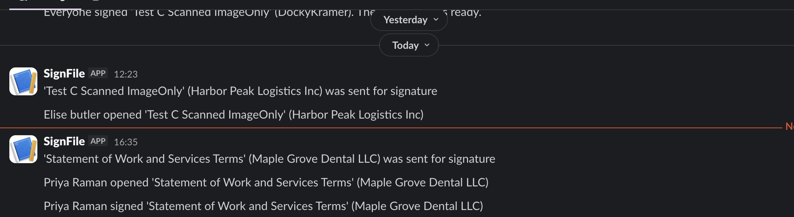
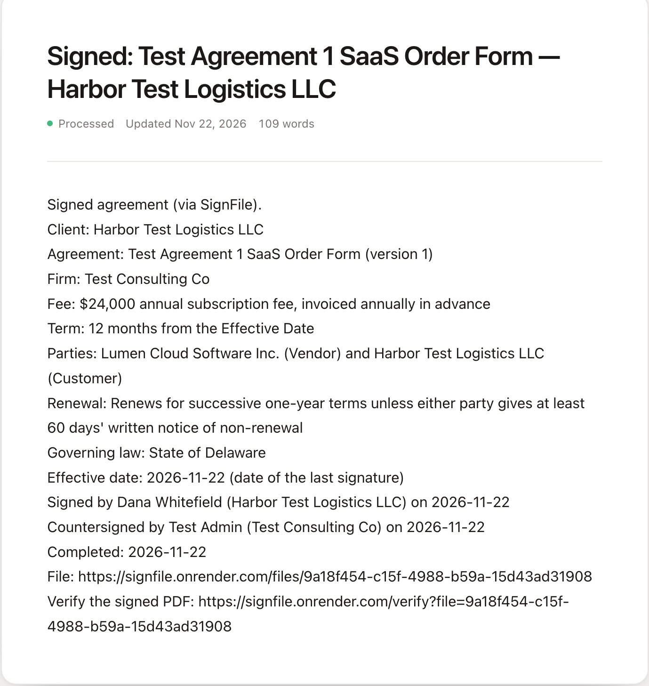
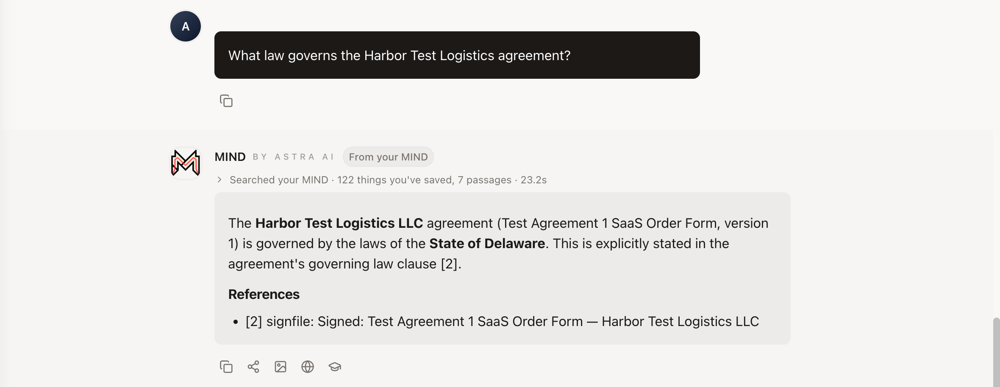

# SignFile

SignFile gets a client agreement signed on every File. A File is one job or case for one client. You upload an agreement template, SignFile finds the signature fields, you check them and send, the client signs, and the signed PDF is sealed with a certificate of completion. When a File completes, SignFile can tell your other systems about it through webhooks, Slack, and MIND.

Built as a take-home for Astra AI.

- Live app: https://signfile.onrender.com
- Design decisions and tradeoffs: [DECISIONS.md](DECISIONS.md)

The live app runs on Render's free tier. An uptime pinger keeps it awake, but if it has been idle, the first request can take 30 to 60 seconds while the container wakes up.

## Test it in 3 minutes

All data in the demo is test data.

| Login | Email | Password |
| --- | --- | --- |
| Firm admin (Astra AI demo company) | `demo@astra-ai.example` | `astra-demo-2026` |

You can also click **Log in to the demo** on the login page, or create your own company at `/signup`.

1. Log in and go to **Templates**. Upload any PDF or Word agreement.
2. Check the detected fields (drag, resize, change type or signer) and save.
3. Create a File: pick the template, enter the client's legal name and the signer's name, title and email, then send.
4. The signing link appears on the File right after sending. Open it in another browser or a private window and sign as the client.
5. Back on the File, countersign as the firm with your own link.
6. Download the sealed PDF and check it at `/verify`.

Every email the app sends is also in the in-app **Outbox**, so you never need a real inbox. To try signing as a client from your inbox, send a File to an address you can open and check spam (see Known limits).

The webhook and Slack integrations are pre-configured on the demo company: after signing a File, see them fire in **Settings → Recent deliveries**. MIND isn't pre-configured; see [MIND sync](#mind-sync) to test it with your own key.

## Try this

- Upload your own agreement (any PDF or Word file) and watch it detect the signature fields.
- Sign a File end to end, download the sealed PDF, and check it at `/verify`. Change one byte and verify again: it fails.
- Open **Settings → Recent deliveries** to see the webhook and Slack fire from one signing.
- Upload the sample CSV (`fixtures/bulk/clients-sample.csv`) in Bulk send and watch it flag a bad row and a duplicate.

> **Use test data only.** This is a demo deployment. Don't enter real names, real email addresses, or real client agreements, whether at signup, as signers, or in uploaded documents. Use made-up names and addresses on a reserved test domain such as `@example.com`. Emails to reserved test domains are captured in the Outbox and never sent.

## What it does

### Core signing flow

1. Upload an agreement (DOCX or PDF). DOCX is converted to PDF with LibreOffice.
2. SignFile detects signature, initials, name, date and title fields and who each belongs to. If it finds none (a scanned PDF, for example), you can append a signature page or place the fields by hand.
3. You review the fields and send. The template and field positions are frozen into the File at send time, so later template edits never change a File in flight.
4. Each signer gets an email link, agrees to sign electronically, signs in the browser (drawn or typed, guided field by field, works on a phone), and the next signer is notified.
5. When everyone has signed, the PDF is sealed: signatures stamped and flattened, and a Certificate of Completion page added.
6. Anyone can check a signed document at `/verify`. Completed Files cannot be edited.

The certificate lists each signer's name and title, UTC and local timestamps, IP, a short browser summary, and the full event log including automatic countersignatures. It fits one page in the usual case and paginates cleanly when it doesn't. It also records the SHA-256 of the original and the sealed PDF.

### AI field and term detection

On upload, a rule-based detector and Claude Haiku (`claude-haiku-5-5`) read the agreement separately. Haiku returns fields, signers and key terms (fee, term, effective date, renewal, parties, governing law), each with its source quote. A missing term is shown as "not found", never guessed. Where the two agree, the field is accepted. Where they disagree, or a field's confidence is below 0.85, the field is flagged "Please confirm this field". If the AI call fails, times out or hits the daily cap (20 reviews per firm), the rules are used alone. Emails and phone numbers are masked before anything goes to the model. The model sits behind one wrapper (`src/lib/llm/`) so it can be swapped.

The AI only proposes. Nothing is sent until a person approves it, and sending, signing, sealing and the audit trail are deterministic code. With no API key (or `AI_ENABLED=false`), everything works on rules alone.

### Managing Files

- **Void** with a reason: links stop working and all parties are emailed.
- **Resend** the signing email (at most once every 10 minutes per signer).
- **Decline** (signer, with a reason): everyone is notified.
- **Request changes** (signer, with a comment).
- **Revise and resend**: upload a new version on the same File. The old version is marked superseded and its links stop working; the same people sign again; the certificate describes only the signed version, while the File's timeline keeps the full history.
- **Reminders and expiry** on a per-firm schedule. An expired link shows a clear page with the firm's name and how to get a new link; "Extend and resend" recovers an expired File.
- **Auto-countersign**, per person: a firm signer saves their signature and turns it on for themselves in Settings (off by default; nobody can turn it on for someone else). It is logged on the certificate.

### Bulk send from CSV

One File per row. Per-template header download. Preview with per-row validation and a validate-only mode. Background sending with batch history and a result CSV. Rows already sent in the last 90 days are skipped, and a single row can be resent on purpose. Cells in the result CSV that a spreadsheet would run as a formula are escaped. A `bulk.completed` event fires when the run finishes. Sample file: `fixtures/bulk/clients-sample.csv`.

## Integrations

All configured per firm in **Settings**, off by default, so one firm's data never goes to another firm's endpoints. Every attempt is in the delivery log, with up to 3 attempts in total and a Retry button. Integrations never block signing.

### Webhooks

SignFile sends a JSON `POST` to your URL for the events you choose:

| Event | When |
| --- | --- |
| `file.sent` | Sent for signature |
| `file.viewed` | Viewed by a signer |
| `file.signed` | Signed (once per signer) |
| `file.completed` | Completed (everyone signed) |
| `file.declined` | Declined |
| `file.changes_requested` | Changes requested |
| `file.voided` | Voided |
| `file.expired` | Expired |
| `bulk.completed` | Bulk send finished (counts) |

Headers on every request:

| Header | Value |
| --- | --- |
| `X-SignFile-Signature` | `sha256=` + hex HMAC-SHA256 of the raw request body, keyed with your signing secret |
| `X-SignFile-Event` | The event name, for example `file.completed` |
| `X-SignFile-Delivery` | Delivery id (also the payload's `id`); use it to ignore duplicates |

Sample `file.completed` payload (times are UTC ISO 8601; `reason` appears on declined, changes requested and voided events; `signedPdfUrl` only on `file.completed`):

```json
{
  "id": "0b6f2c1e-6a51-4c39-9d0f-3f1f4b0d8a11",
  "type": "file.completed",
  "occurredAt": "2026-11-22T18:04:12.345Z",
  "file": {
    "id": "9a18f454-c15f-4988-b59a-15d43ad31908",
    "reference": "HTL-2026-01",
    "status": "completed",
    "client": "Harbor Test Logistics LLC",
    "document": "Test Agreement 1 SaaS Order Form",
    "sentAt": "2026-11-22T17:50:03.120Z",
    "completedAt": "2026-11-22T18:04:12.001Z",
    "expiresAt": "2026-12-06T17:50:03.120Z"
  },
  "signer": null,
  "signers": [
    { "role": "client", "name": "Dana Whitefield", "email": "dana@example.com", "status": "signed", "signedAt": "2026-11-22T17:58:40.511Z" },
    { "role": "firm", "name": "Test Admin", "email": "admin@example.com", "status": "signed", "signedAt": "2026-11-22T18:04:11.870Z" }
  ],
  "signedPdfUrl": "https://signfile.onrender.com/api/sign/<token>/download"
}
```

`bulk.completed` has `id`, `type`, `occurredAt` and `batch` (`id`, `template`, `counts`, `resultCsvUrl`) instead of `file` and `signers`.

To verify a request, compute the HMAC over the raw body exactly as received (before parsing JSON) and compare in constant time:

```js
import { createHmac, timingSafeEqual } from "node:crypto";

function isFromSignFile(rawBody, header, secret) {
  const expected = "sha256=" + createHmac("sha256", secret).update(rawBody, "utf8").digest("hex");
  return typeof header === "string" && header.length === expected.length && timingSafeEqual(Buffer.from(header), Buffer.from(expected));
}
// isFromSignFile(rawBody, req.headers["x-signfile-signature"], process.env.SIGNFILE_WEBHOOK_SECRET)
```

Return any 2xx to acknowledge. Anything else, or no answer within 10 seconds, is retried after 30 seconds and then 5 minutes.

### Slack

Paste a Slack incoming webhook URL in Settings and pick the events. Each event is one short line in the channel.


*SignFile posts each event to the firm's Slack channel.*

### MIND sync

When a File completes, SignFile can save it as one private document in the firm's MIND (off by default; each firm adds its own MIND API key in **Settings**). The document carries the client, agreement version, key terms, signers and dates, and a link to `/verify`. It never sends signer emails or phone numbers. Why it works this way: see `DECISIONS.md`.

To test MIND, paste your own MIND API key in **Settings → MIND**, turn it on, then sign a File. The completed document appears in your MIND graph.


*A signed File saved as a private document in MIND.*


*MIND answering a question about the agreement, citing the SignFile document as its source.*

## Running it locally

Needs Node.js 22 (the version in the Dockerfile), Docker, and a Supabase project (Postgres plus Storage). An Anthropic API key and Gmail API access are optional: without a key, detection runs on rules only; without Gmail, emails are recorded in the in-app Outbox and not sent.

```bash
git clone <repo-url> signfile && cd signfile
cp .env.example .env.local     # fill in the values below
npm install
npm run db:setup               # runs migrations on DATABASE_URL and creates the private storage bucket
npm run db:verify              # checks RLS, grants, the insert-only audit log and the purge function
npm run seed                   # creates the Astra AI demo company and demo login

docker build -t signfile .
docker run --rm --env-file .env.local -p 10000:10000 signfile
# open http://localhost:10000
```

`npm run dev` also works (http://localhost:3000) if LibreOffice is installed locally; on macOS set `SOFFICE_PATH=/Applications/LibreOffice.app/Contents/MacOS/soffice`.

**Setup note:** set a monthly spend limit in the Anthropic console before adding an API key. If the limit is hit, every AI feature falls back to its non-AI path.

### Environment variables

| Variable | Purpose |
| --- | --- |
| `DATABASE_URL` | Supabase Postgres, **session pooler** URI (port 5432) |
| `DB_POOL_MAX` | App connection pool size per process (default 3) |
| `MIGRATION_DATABASE_URL` | Optional separate URI for migrations; falls back to `DATABASE_URL` |
| `SUPABASE_URL` | Supabase project URL (Storage) |
| `SUPABASE_SERVICE_ROLE_KEY` | Supabase secret key, server side only |
| `STORAGE_BUCKET` | Private bucket for PDFs and logos (default `signfile`, created by `db:setup`) |
| `SOFFICE_PATH` | Path to LibreOffice's `soffice`; leave empty in Docker |
| `LO_PROFILE_DIR` | Pre-built LibreOffice profile (set in the Dockerfile); leave empty locally |
| `QPDF_PATH` | Path to `qpdf` (strips permission-only encryption from uploads); defaults to `qpdf` on PATH |
| `APP_URL` | Optional public base URL for links in emails; defaults to the request's host |
| `GMAIL_CLIENT_ID`, `GMAIL_CLIENT_SECRET`, `GMAIL_REFRESH_TOKEN`, `GMAIL_SENDER` | Gmail API, to send email from the firm's account. Optional |
| `BULK_ROW_DELAY_MS` | Pause between rows in a bulk send (default 400) |
| `E2E_HOOKS` | Test only: enables the mocked-time endpoint and test receivers. Never set in production |
| `ENABLE_SWEEP` | `1` runs the reminder and expiry sweep. Set in production only, since local and production can share a database |
| `ANTHROPIC_API_KEY` | Claude API key. Optional; never logged |
| `AI_ENABLED` | `false` turns the AI review off even with a key |
| `AI_DAILY_CAP` | AI reviews per firm per 24 hours (default 20) |
| `AI_MODEL` | Model override (default `claude-haiku-5-5`) |
| `LLM_MOCK` | Test only: mock model for "E2E AI" test companies. Never set in production |
| `MIND_API_KEY` | Only for one-off verification scripts; the app uses each firm's own key from Settings |
| `MIND_MCP_URL` | Test only (with `E2E_HOOKS=1`): points MIND sync at the mock server |

Webhook, Slack and MIND settings live in each firm's Settings, not in env vars.

### Tests

```bash
npm run test:unit              # unit tests (node:test via tsx)
npm run typecheck
npm run lint

# E2E (Playwright): build and start the image with email, AI and MIND mocked, then run the suite against it
docker build -t signfile:dev .
docker run -d --rm --env-file .env.local \
  -e GMAIL_CLIENT_ID= -e GMAIL_CLIENT_SECRET= -e GMAIL_REFRESH_TOKEN= -e GMAIL_SENDER= \
  -e E2E_HOOKS=1 -e LLM_MOCK=1 -e ANTHROPIC_API_KEY= \
  -e MIND_API_KEY= -e MIND_MCP_URL=http://host.docker.internal:4790/mcp \
  -p 10000:10000 signfile:dev
E2E_BASE_URL=http://localhost:10000 npx playwright test --project=desktop
```

`npm run test:e2e` runs the desktop and phone projects. Pointed at the live URL (`E2E_BASE_URL=https://signfile.onrender.com`), the config runs only the short smoke test. Test accounts use `@signfile-e2e.example` and are deleted when the run ends.

Other scripts: `npm run gen:agreements` regenerates the varied test agreements in `fixtures/agreements`; `npm run purge:company -- <company-id>` deletes a company and all its Files (dry run first, then add `--confirm`); `npx tsx scripts/seed-demo-files.ts` adds two completed example Files to the demo company through the real signing flow (run it against the Docker image; `--rehearse` tries it in a throwaway company first).

## Stack

Next.js and TypeScript in Docker on Render's free tier; Supabase Postgres and Storage; Drizzle ORM; LibreOffice for DOCX; pdfjs-dist and pdf-lib for reading, stamping and sealing; rules plus Claude Haiku for detection; Gmail API over HTTPS; an internal event dispatcher driving webhooks, Slack and MIND.

## Known limits

- Emails may land in spam: they are sent from a free Gmail account. Production would use a verified domain with SPF and DKIM.
- Reminders and expiry run on the health check, which an external uptime pinger hits every 10 minutes because the free tier sleeps. A job scheduler such as Inngest would remove that dependency.
- Bulk send is paced at 0.4 seconds per row to stay within Gmail limits.
- MIND uses an API key, not OAuth. A "Connect MIND" button would be nicer; I used a key to prove the integration end to end in the time I had.

## Left out on purpose

More detail in [DECISIONS.md](DECISIONS.md).

- Forwarding a File to another signer: least used, and those handoffs happen outside the signing tool.
- Calendar, reply-by-email, SMS, Stripe billing: none removes a manual step from getting an agreement signed.
- AI-written reminder emails: templates work, and a model adds cost and unpredictable wording to client emails.
